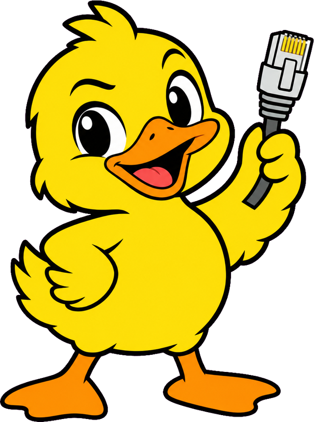
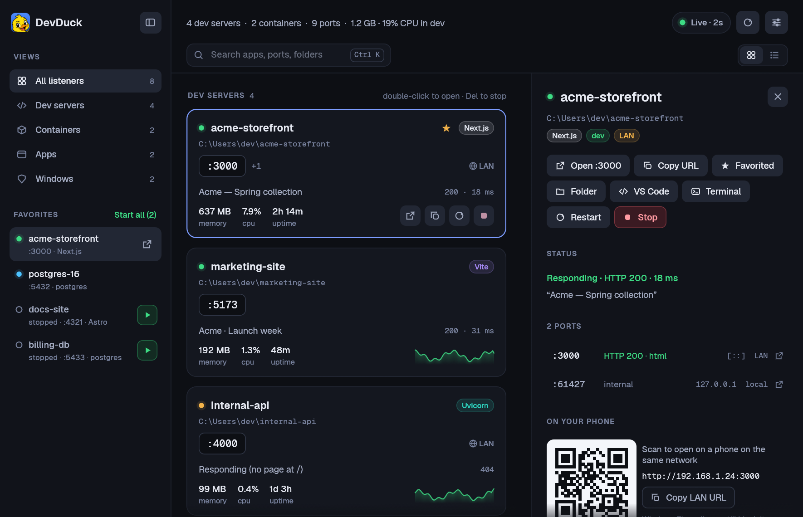
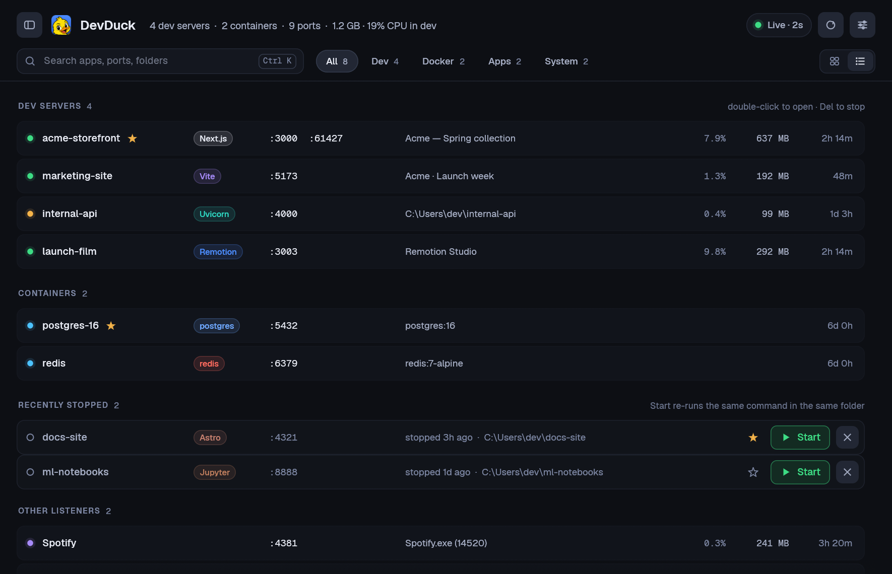

<p align="center"></p>

<h1 align="center">DevDuck</h1>

<p align="center"><b>Every dev server on your PC, grouped by project.</b><br><a href="https://drhalto.github.io/devduck/">drhalto.github.io/devduck</a></p>

A Windows dashboard for the dev servers on your machine. It shows **what's listening on your local ports**, grouped by project, says what each one is and whether it's answering, and lets you **open, restart or stop it cleanly**: the whole process tree, not just one PID.



If you run a lot of dev servers, you know the pain: something's holding port 3000, `netstat` gives you a bare PID, and killing it leaves orphaned `node` children behind. DevDuck works out which *project* a listener belongs to, shows it as a card, and handles the rest.

## What it does

- **One card per dev server.** Listeners are grouped by project folder (walking the process tree past npm/vite/next runners), so five ports from one `next dev` are one card, not five.
- **Says what it is.** Framework badge (Next.js, Vite, Remotion, Astro, Storybook, Uvicorn, Django...) from the command line and `package.json`; the page's real `<title>`; HTTP status and latency; which port is the web port and which are internal.
- **Live.** Rescans every 2 s (adjustable, or pause), with CPU and memory sparklines. Memory and CPU cover the **whole process tree**, which is what stopping it would free.
- **Restart and Start.** Restart stops the tree and re-runs the exact command in the same folder. Stopped projects stay under *Recently stopped* with a **Start** button. Servers DevDuck starts have their output captured, and the drawer shows their logs.
- **Favorites in a sidebar.** Star a dev project or container and it stays in the sidebar whether it's running or not: a live status dot while it's up, a **▶** to start it when it's down (dev servers re-run their remembered command; containers get `docker start`), **Start all** for the stopped ones, and a right-click menu. The sidebar also holds the All / Dev / Docker / Apps / Windows views; hide it with `Ctrl B`.
- **Detail drawer.** Ports with bind addresses (localhost-only vs. reachable on your LAN), a **QR code** to open it on your phone, the process tree, the command line and working directory, plus logs (Docker logs for containers).
- **Docker aware.** Ports published by containers show as container cards (name, image, uptime). Stop is `docker stop`, Restart is `docker restart`.
- **Jump-offs:** open in browser, copy URL, open the folder, open it in VS Code or Cursor, open a terminal there.
- **A real CLI** for scripts and agents: `devduck who 3000`, `devduck kill 3000`, `devduck list --json`.



## Install

Requires Windows 10/11 and Rust 1.88+ (MSVC toolchain). From the repo:

```powershell
.\scripts\install.ps1
```

That builds the release, copies the two programs to `~\.local\bin` (pass `-Dest` to pick another folder on your `PATH`) and adds a **DevDuck** Start menu shortcut. Re-run it after pulling changes.

| | |
|---|---|
| `devduck-app.exe` | The window. Open it once and right-click its taskbar icon, **Pin to taskbar**. Launching it again just brings the open window forward. |
| `devduck.exe` | The command line. With no arguments it opens the window. |

There's nothing to configure, and admin rights aren't required (though admin lets you stop processes owned by other users).

## Command line

```text
devduck                 open the window
devduck list            every listener as a table   (alias: --smoke)
devduck list --json     ...as JSON, with bind addresses, framework, process count, cwd
devduck who 3000        what's on a port: app, folder, process tree, command
devduck kill 3000       stop whatever owns a port (whole tree, or docker stop)
devduck open 3000       open http://localhost:3000
```

`kill` won't touch Windows system processes. Exit codes: `0` done, `1` nothing on that port (or the stop failed), `2` refused or bad usage.

## Keyboard

| Key | |
|---|---|
| `Ctrl K` / `Ctrl F` | search apps, ports, folders, frameworks and page titles |
| `↑` `↓` | move between servers (opens the drawer) |
| `Enter` | open the selected server in the browser |
| `Del` | stop the selected server |
| `F5` / `Ctrl R` | refresh now |
| `Ctrl B` | show or hide the sidebar |
| `Esc` | clear search, then close the drawer |

## How the grouping works

For each listening TCP socket, DevDuck:

1. Looks up the owning process and its command line.
2. Finds the project directory: the path segment before `\node_modules\`, or else the first folder under your user profile that isn't `AppData` or an executable.
3. Walks *up* the parent chain (up to 8 levels) while the parent is part of the same project or is a known dev runner (`npm`, `pnpm`, `yarn`, `vite`, `next`, `turbo`, `nodemon`, `dotnet watch`, `uvicorn`, `flask`...), stopping at shells, editors and other "never kill" roots.

That root is what Stop kills (`taskkill /T`) and what Restart re-runs. These rules are carried over unchanged from the original PowerShell version (v1, in the git history), and the scan was checked against its output row for row.

## Safety and privacy

- A confirmation names the app, the process and how many child processes will end (you can turn it off in Settings).
- Windows kernel listeners and a curated "never kill" list (Explorer, terminals, VS Code, Cursor, Visual Studio, core Windows services) are never walked into or terminated. The CLI refuses system processes outright.
- Restart, Start and favorites only ever run a command DevDuck saw running from that folder.
- HTTP checks: DevDuck sends one `GET /` to each **dev server** port when it first appears, and again when you open its drawer or click Re-check. It never probes containers, apps, system services or internal (49152+) ports. You can turn this off in Settings.
- State (settings, favorites, recently stopped projects) lives in `%APPDATA%\DevDuck\state.json`; logs of servers it starts are in `%APPDATA%\DevDuck\logs`. Nothing leaves your machine.

## Under the hood

Rust, [egui](https://github.com/emilk/egui)/eframe for the window, and direct Win32 calls for everything else: one `NtQuerySystemInformation` call for the process table, `GetExtendedTcpTable` for listeners, process command lines and working directories read without WMI. A full scan takes about 10 ms; the PowerShell version took about a second.

DevDuck was called Dev Ports until v2.1 (its data folder moves over automatically). v1 was a single-file PowerShell/WPF script, `DevPorts.ps1`, still in the git history.

## License

MIT. Mascot drawn with gpt-image-2. Fonts: [Geist and Geist Mono](https://vercel.com/font) by Vercel, SIL Open Font License (see `assets/fonts/OFL.txt`).
